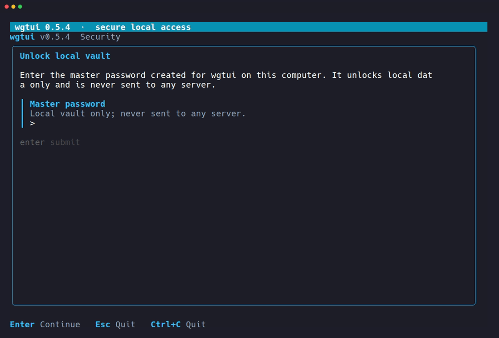

<div align="center">
  <h1>wgtui</h1>
  <p><strong>A terminal control panel for the WireGuard servers you already run.<br>No web dashboard. No agent daemon. No mesh network to join.</strong></p>

  [](LICENSE)
  [](https://github.com/DMYTROSKORIN/wgtui/releases/latest)
  [](#installing)
  [](https://go.dev)
  [](https://github.com/charmbracelet/bubbletea)
</div>

---



---

## Installing

```bash
curl -fsSL https://raw.githubusercontent.com/DMYTROSKORIN/wgtui/master/scripts/install.sh | bash
```

Same command on **Linux and macOS** (amd64 or arm64) - the script detects
your OS/arch, downloads the matching release, verifies `checksums.txt`,
and installs a single static binary, man page, and shell completions
under `~/.local/` - no root required, ever. Re-run it after each release
to update; `wgtui version` tells you when a newer one exists but never
installs it itself.

<details>
<summary>More install options</summary>

**Install a specific version:**

```bash
curl -fsSL https://raw.githubusercontent.com/DMYTROSKORIN/wgtui/master/scripts/install.sh | WGTUI_VERSION=v0.5.9 bash
```

**From a local clone:**

```bash
scripts/install.sh          # latest release
scripts/install.sh v0.5.9   # a specific release
```

**`.deb`/`.rpm` packages** are also published if you specifically want a
system-managed install instead (these do need root):

```bash
sudo dpkg -i wgtui_*.deb   # Debian/Ubuntu
sudo rpm -i wgtui_*.rpm    # Fedora
```

**Build from source:**

```bash
go build ./...
```

</details>

**Control client:** Linux amd64/arm64, macOS amd64/arm64.
**Managed server:** Ubuntu, Debian, or Fedora with systemd - macOS is a
client-only platform here, never a managed server.

---

## Why wgtui

`wgtui` connects to your own Linux server over plain SSH, discovers whatever
WireGuard setup is already there (or helps you build one from scratch), and
gives you a fast, keyboard-and-mouse-driven terminal UI to manage interfaces
and peers - without installing anything but standard `wireguard-tools` on
the server itself.

Most WireGuard tooling asks you to change how your VPN works: adopt a mesh
network and a coordination server (Tailscale, Headscale, Netmaker), or run a
persistent web app *on* the VPN server itself (wg-easy, wireguard-ui) that
generates its own client keys and becomes one more service you have to keep
patched, exposed, and backed up.

`wgtui` doesn't ask for any of that. It manages the WireGuard server you
already have, or a completely bare one, using only SSH and the standard
`wg`/`wg-quick` tools - the same thing you'd type by hand, just done
correctly and consistently, without the muscle memory or the sitting-in-front-
of-`vim`-on-a-VPS part.

- **The server stays boring.** Nothing runs on it but WireGuard and SSH -
  the same footprint as a server nobody is "managing" at all. No web UI to
  patch, no daemon to keep alive, no extra listening port.
- **Client private keys never touch the server.** They're generated on your
  machine and stay in an encrypted local vault; the server only ever
  receives a public key. Tools that generate keys server-side have, at some
  point, held every client's private key - `wgtui` structurally can't.
- **Nothing happens without a plan you can read first.** Every mutating
  action - install, configure, add/revoke/rotate a peer - shows the exact
  commands or config change before it runs, and asks you to confirm it.
  Config writes go through a locked, verified, roll-back-on-failure
  transaction, not a blind overwrite.
- **One tool, three front doors, one safety model.** The same validated
  core drives a terminal UI for a human, a scripting-friendly CLI, and an
  [MCP](https://modelcontextprotocol.io) server for AI agents - so
  automating or asking an assistant to do it never bypasses the
  confirmations a human would get.
- **One static binary.** Pure Go, no Docker, no Python, no Node, no browser.
  Cross-compiles for Linux and macOS and runs the same way on both.
- **Manages more than one server.** Every server you add lives in one
  encrypted local registry, switchable from the same screen.

### Who it's for

Anyone running their own WireGuard server - a VPS, a homelab box, a rack in
a closet - who's currently either hand-editing `/etc/wireguard/wg0.conf`
over SSH, or has been eyeing a heavier platform just to avoid that. If you
already trust your own machine to `ssh` into your servers, `wgtui` is the
missing piece between "raw config file" and "adopt an entire VPN platform."

It is *not* a mesh networking product, not a hosted service, and it will
never ask a server to run anything beyond stock WireGuard.

---

## What it does

- Connects to a server over SSH (key, `ssh-agent`, or interactive password) -
  discovers the current WireGuard state read-only before anything else.
- Shows interface and peer state, handshake age, endpoint, and traffic
  counters at a glance.
- Walks a bare server through installing WireGuard and creating its first
  interface, then straight into that setup - no separate, easy-to-miss step.
- Generates client keypairs **locally**; the server only ever receives a
  public key. A ready `.conf` and QR code are produced on your machine, no
  `scp` required.
- Gives new client profiles an editable DNS default, so a full-tunnel client
  doesn't silently inherit a resolver you didn't choose.
- Adds, pauses, resumes, rotates, and revokes peers, each as a locked,
  verified, rollback-on-failure transaction with an ephemeral recovery copy.
- Runs the exact same operations from a terminal UI, a scriptable CLI, or an
  MCP server for AI agents - one validated core behind all three.

## Using the terminal UI

```bash
wgtui
```

opens the full-screen dashboard. The very first run asks you to set a local
master password that encrypts the server/peer registry on disk - it's never
sent anywhere. SSH, host-key, and sudo prompts also happen as in-app dialogs
that name the exact server they're for; nothing password-related ever drops
you back to a plain terminal prompt.

Two accelerator systems, never sharing a key: **`Alt+letter`** always opens
a top-menu category (Server, Peer, View, Tools, Help) regardless of screen;
a plain **letter** runs whatever this specific screen offers, shown as a
highlighted letter inside its own label on the bottom bar. `M` opens the
menu without a modifier, `?` shows full keyboard help, `Q`/`Ctrl+C` exits
safely. Every menu item and bottom-bar action is also just a mouse click.

The minimum usable size is `64×18`; `90×24` or larger is recommended. Layout
adapts automatically between compact, standard, and wide as the terminal
resizes.

## Using the CLI

Every TUI action has a scriptable equivalent:

```bash
wgtui server add office --ssh-host 203.0.113.10 --ssh-user root
wgtui server install-wireguard office
wgtui server configure office --vpn-cidr 10.10.0.0/24
wgtui peer add office --name laptop --full-tunnel --qr
wgtui peer list office --json
wgtui peer revoke office laptop
wgtui diagnose office
```

Run `wgtui help` for the full command surface. Every command that needs
network access prompts interactively for SSH/sudo credentials the same way
the TUI does - never via an argument or environment variable.

## Using it from an AI agent (MCP)

`wgtui mcp` runs a separate, non-interactive
[MCP](https://modelcontextprotocol.io) server over stdio, so an AI agent (or
any MCP client) can drive `wgtui` the same way a human drives the TUI - same
discovery, same plan-before-apply, same explicit confirmation for every
mutation. It's a distinct mode, launched by the MCP client itself, not
something the interactive TUI exposes while it's running.

**If you use Claude Code** (the CLI), one command registers it:

```bash
claude mcp add wgtui --env WGTUI_MASTER_PASSWORD='your vault master password' -- wgtui mcp
```

**If you use Claude Desktop** (or any other MCP-capable client), add the
same thing as JSON to its MCP config file (Claude Desktop:
`claude_desktop_config.json`) and restart the client:

```json
{
  "mcpServers": {
    "wgtui": {
      "command": "/home/you/.local/bin/wgtui",
      "args": ["mcp"],
      "env": { "WGTUI_MASTER_PASSWORD": "your vault master password" }
    }
  }
}
```

Either way, that's the entire setup - there is no server to start by hand,
no port to open, nothing else to run. The client itself launches `wgtui mcp`
as a subprocess and talks to it over stdio whenever it decides it needs to.
From then on, just talk to the assistant in plain language in a normal
conversation - e.g. *"list my wgtui servers"* or *"add a peer called laptop
on office and show me the QR code"*. You never type a command or name a
tool; the assistant sees `wgtui`'s tools are available and reaches for them
on its own, the same way it reaches for any other tool it has.

**What you get:** `list_servers`, `server_inspect`, `server_diagnose`, and
`peer_list` are read-only. `peer_add`, `peer_disable`, `peer_enable`,
`peer_revoke`, and `peer_rotate` mutate, and every one of them takes a
`confirm` argument that defaults to `false` - the agent is expected to show
you the resulting plan first and only pass `confirm=true` after you've
actually agreed to it, the same "plan, then confirm" flow as the TUI and
CLI. A server's SSH host key has to be trusted once from a real terminal
(TUI or `wgtui server inspect`) before that server can be driven through
MCP at all - there's no terminal here to show a first-time fingerprint on,
so this mode never approves one itself.

**About that `WGTUI_MASTER_PASSWORD` line:** it's a real trade-off, not a
formality, and worth understanding before you paste a real password into a
client config. Everywhere else in `wgtui`, the master password only exists
transiently in memory. Baked into a client's config file like this, it
instead sits in **plaintext on disk indefinitely**, protected only by that
file's normal filesystem permissions. If that's more exposure than you
want: keep a vault used for MCP scoped to servers you're fine with an
agent having standing access to, use a separate vault from your primary
one, or wrap `wgtui mcp` in a small launcher script that pulls the password
from your OS keyring (`secret-tool`, `pass`, ...) instead of a static
config value - `wgtui` only ever reads the literal environment variable, so
where that value actually comes from is entirely up to you.

---

## Security posture

- The server's WireGuard private key never leaves the server; client
  private keys never touch the server.
- Strict SSH host-key verification, always - no option to disable it.
- Every mutating remote operation uses a locked temporary copy, verifies
  the result, and rolls back on failure; the copy is kept only if recovery
  itself fails.
- No secret is ever passed as a process argument, logged, or included in
  `--json` output.
- Local state lives in `~/.wgtui-config/vault.json`, encrypted under your
  master password. An explicit export creates a `0700` bundle with a
  profile and QR PNG, both mode `0600`.
- `wgtui` refuses to run as root, so local keys can't silently end up in
  root's home directory.

Full write-up, including the MCP front end's different credential model:
[`docs/THREAT_MODEL.md`](docs/THREAT_MODEL.md).

## Development

```bash
scripts/install-git-hooks.sh   # once per clone: enables the pre-push Semgrep gate
scripts/semgrep-scan.sh        # run it manually any time
```

Every push is scanned with [Semgrep](https://semgrep.dev)
(`p/golang`, `p/security-audit`, `p/secrets`), enforced in CI
(`.github/workflows/ci.yml`) and, once the hook above is installed,
locally too. See [`docs/ARCHITECTURE.md`](docs/ARCHITECTURE.md) for how the
codebase is organized and [`docs/SPEC.md`](docs/SPEC.md) for the full
behavioral specification.

Contributions, issues, and forks are welcome - fork it, improve it, break
it, fix it.

---

## License

[](LICENSE)

Released under the [Apache License 2.0](LICENSE).
